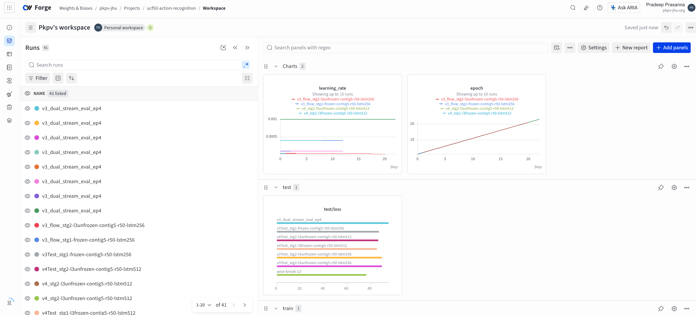
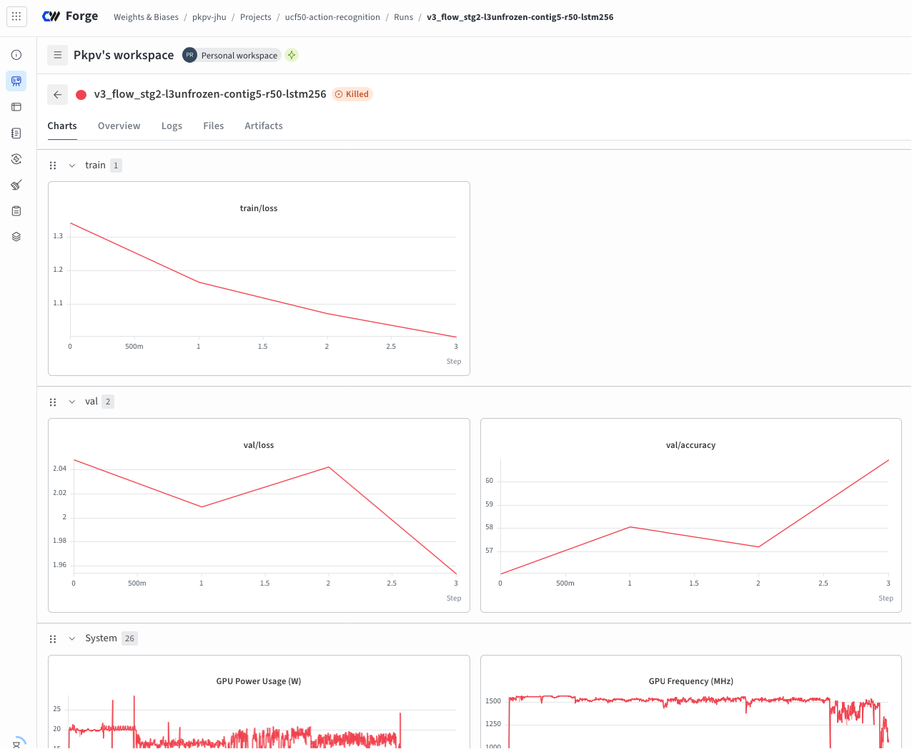
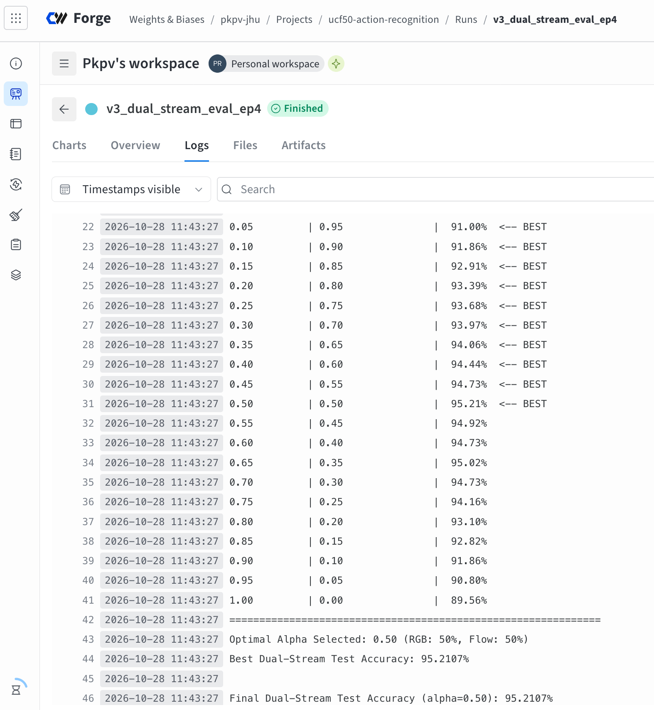

# Two-Stream LRCN Action Recognition on UCF50

[](https://wandb.ai/pvpradeep/jhu_dlpyt_a4)
[](https://pytorch.org/)
[](https://github.com/pvpradeep/jhu_dlpyt_a4)

This repository implements an end-to-end deep learning framework for action recognition on the 50-class **UCF50** dataset using a **Decoupled Two-Stream Long-term Recurrent Convolutional Network (LRCN)**. The architecture processes 3-channel spatial RGB frames and 3-channel HSV-encoded Farneback Optical Flow fields via fine-tuned ResNet50 backbones and 2-layer stacked LSTMs. Late soft-voting logit fusion at $\alpha = 0.50$ achieves **95.21% Test Accuracy**, exceeding the target baseline (>93.00%) by +2.21 percentage points.

> 📊 **Experiment Auditing:** Complete training curves, loss profiles, hyperparameter sweeps, and single-stream vs. dual-stream evaluation runs are tracked on [Weights & Biases Workspace](https://wandb.ai/pkpv-jhu/ucf50-action-recognition).

---

## Table of Contents

- [System Architecture](#system-architecture)
- [Project Structure](#project-structure)
- [Environment Setup](#environment-setup)
- [Dataset Ingestion & Flow Extraction](#dataset-ingestion--flow-extraction)
- [Training Strategy](#training-strategy)
- [Testing & Dual-Stream Evaluation](#testing--dual-stream-evaluation)
- [Experimental Progression & Results](#experimental-progression--results)
- [Hyperparameters & Configuration](#hyperparameters--configuration)
- [Running Unit Tests](#running-unit-tests)

---

## System Architecture

```
                               ┌───────────────────────────┐
                       ┌──────►│   RGB Stream (ResNet50)   │──────┐
                       │       │ + 2-Layer LSTM (256-dim) │      │
┌──────────────────┐   │       └───────────────────────────┘      │
│ Input Video      ├───┤                                          ├─► [Weighted Logit Fusion] ─► 95.21% Test Acc
│ (UCF50 Dataset)  │   │       ┌───────────────────────────┐      │   (α = 0.50 Soft-Voting)
└──────────────────┘   └──────►│ Optical Flow Stream (HSV) │──────┘
                               │ + 2-Layer LSTM (256-dim) │
                               └───────────────────────────┘

```

* **Spatial Stream (RGB):** Captures scene context, actor appearance, and object semantics from 16-frame contiguous clips.
* **Temporal Stream (Optical Flow):** Isolates motion velocity, acceleration, and movement trajectories via Farneback 2D motion vector fields mapped to HSV color space.
* **Two-Stage Fine-Tuning:** Stage 1 trains the 2-layer stacked LSTM head (256 hidden units) while keeping the ResNet50 backbone frozen. Stage 2 unfreezes deeper convolutional layers (`layer3+`) using a $0.1\times$ differential learning rate ($4\times 10^{-5}$).
* **Temporal Sampling & Pooling:** Evaluates 5 contiguous 16-frame clips per video (`[5, 16, 3, 224, 224]`). Features are temporally mean-pooled across LSTM time steps (`out.mean(dim=1)`), and clip predictions are averaged per video.
* **Late Soft-Voting Fusion:** Convex linear logit combination across spatial and temporal streams:

$$\mathbf{L}_{\text{fused}} = \alpha \cdot \mathbf{L}_{\text{RGB}} + (1 - \alpha) \cdot \mathbf{L}_{\text{Flow}}$$


---

## Project Structure

```text
.
├── data/
│   ├── UCF50_frames_contig_5clips/    # Sampled RGB frame sequences
│   └── UCF50_flow_contig_5clips/      # Extracted Farneback Optical Flow HSV frames
├── outputs/
│   ├── logs/                          # Console and runtime execution logs
│   ├── models/                        # Saved model checkpoints (.pt)
│   └── splits.npy                     # Group-aware train/val/test split indices
├── scripts/
│   ├── train.sh                       # Single-stream Stage 1/2 training runner
│   └── test.sh                        # Dual-stream soft-voting evaluation runner
└── src/
    ├── extract_flow.py                # Dense Farneback optical flow computation
    ├── logger.py                      # Dual console/file logging pipeline
    ├── models.py                      # LRCN model architecture & unfreezing API
    ├── preprocess.py                  # Video extraction and dataset restructuring
    ├── run.py                         # Execution driver CLI and mode router
    ├── test.py                        # Standalone & dual-stream evaluation engine
    ├── train.py                       # Epoch loops, validation tracking & early stopping
    ├── utils.py                       # Seed-synchronized transforms & dataloaders
    ├── video_datasets.py              # Group-aware regex splitting & frame loading
    └── wandb_utils.py                 # Weights & Biases experiment auditing

```

---

## Environment Setup

### Prerequisites

* Python 3.10+
* PyTorch 2.0+ (CUDA or Apple Silicon `mps` acceleration supported)

### Installation

```bash
# Clone repository
git clone https://github.com/pvpradeep/jhu_dlpyt_a4.git
cd ucf50-action-recognition

# Install dependencies
pip install -r requirements.txt

```

#### Key Dependencies

* `torch`, `torchvision`
* `opencv-python`
* `scikit-learn`
* `wandb`
* `numpy`, `pillow`, `tqdm`

---

## Dataset Ingestion & Flow Extraction

### 1. Download Dataset

Download the 50-class UCF50 dataset and organize video files into category directories:

```text
UCF50/
├── BaseballPitch/
├── Basketball/
├── BenchPress/
└── ... (50 categories)

```

### 2. Extract RGB Clips

Run `preprocess.py` to sample 5 contiguous 16-frame clips per video:

```bash
python src/preprocess.py \
  --input_dir ./data/UCF50 \
  --output_dir ./data/UCF50_frames_contig_5clips \
  --clips_per_video 5 \
  --frames_per_clip 16

```

### 3. Compute Farneback Optical Flow

Generate 3-channel HSV dense optical flow maps from RGB frame sequences:

```bash
python src/extract_flow.py \
  --input_dir ./data/UCF50_frames_contig_5clips \
  --output_dir ./data/UCF50_flow_contig_5clips

```

---

## Training Strategy

Training uses group-aware dataset splits (`r'_g(\d+)_'`) to isolate entire actor/recording groups into `train` (75%), `val` (10%), and `test` (15%) sets, eliminating train-test data leakage.

### Stage 1: Train Temporal LSTM Head (Frozen Backbone)

Train the LSTM head on RGB frames using a frozen ResNet50 backbone:

```bash
python src/run.py \
  --mode train \
  --model_type lrcn \
  --cnn_backbone resnet50 \
  --frame_dir ./data/UCF50_frames_contig_5clips \
  --rnn_hidden_size 256 \
  --rnn_n_layers 2 \
  --batch_size 32 \
  --learning_rate 1e-3 \
  --n_epochs 30 \
  --run_name v3_stg1_rgb_frozen

```

### Stage 2: Fine-Tune Deeper Layers (`layer3+`)

Unfreeze deeper backbone convolutional blocks (`layer3` and `layer4`) with a differential learning rate:

```bash
# RGB Stream Stage 2
python src/run.py \
  --mode train \
  --model_type lrcn \
  --cnn_backbone resnet50 \
  --frame_dir ./data/UCF50_frames_contig_5clips \
  --ckpt ./outputs/models/v3_stg1_rgb_frozen_best_model_wts.pt \
  --unfreeze_layer layer3 \
  --learning_rate 4e-4 \
  --n_epochs 20 \
  --run_name v3_stg2_rgb_unfrozen

# Optical Flow Stream Stage 2
python src/run.py \
  --mode train \
  --model_type lrcn \
  --cnn_backbone resnet50 \
  --frame_dir ./data/UCF50_flow_contig_5clips \
  --ckpt ./outputs/models/v3_stg1_flow_frozen_best_model_wts.pt \
  --unfreeze_layer layer3 \
  --learning_rate 4e-5 \
  --n_epochs 20 \
  --run_name v3_stg2_flow_unfrozen

```

Alternatively, launch training passes using the provided shell script wrapper:

```bash
bash scripts/train.sh

```

---

## Testing & Dual-Stream Evaluation

Evaluate standalone streams and execute a single-pass vectorized alpha grid search ($\alpha \in [0.00, 1.00]$) to discover the optimal fusion weight:

```bash
python src/run.py \
  --mode eval_dual \
  --frame_dir ./data/UCF50_frames_contig_5clips \
  --flow_dir ./data/UCF50_flow_contig_5clips \
  --ckpt_rgb ./outputs/models/v3_stg2-frozen-contig5-r50_best_model_wts.pt \
  --ckpt_flow ./outputs/models/v3_flow_stg2-l3unfrozen-contig5-r50-lstm256_best_model_wts.pt \
  --run_name v3_dual_stream_eval

```

Or execute via shell script:

```bash
bash scripts/test.sh

```

### Evaluation Output Format

`test_dual_stream()` performs video-level mean-pooling across clip predictions, evaluates individual streams, outputs an alpha-sweep grid search table, and logs the final classification metrics:

```text
Standalone RGB Stream Accuracy:  89.56%
Standalone Flow Stream Accuracy: 89.66%

==============================================================
ALPHA SWEEP GRID SEARCH (RGB vs. Flow Fusion Weight)
==============================================================
Alpha (RGB)  | 1 - Alpha (Flow)   | Test Accuracy
--------------------------------------------------------------
0.00         | 1.00               |  89.66%
...
0.50         | 0.50               |  95.21%  <-- BEST
...
1.00         | 0.00               |  89.56%
==============================================================
Optimal Alpha Selected: 0.50 (RGB: 50%, Flow: 50%)
Final Dual-Stream Test Accuracy (alpha=0.50): 95.2107%

```
---

## Experimental Progression & Results

### Iteration Progression Summary

| Iteration | Stream | Backbone Setup | Training Strategy | Standalone Test Acc | Fused Test Acc ($\alpha=0.50$) |
| --- | --- | --- | --- | --- | --- |
| **Iter 1** | RGB | ResNet50 (Frozen) | Stage 1: Train 2-layer LSTM (256 hidden) | 71.20% | — |
| **Iter 2** | RGB | ResNet50 (`layer3+` Unfrozen) | Stage 2: Fine-tune ($LR = 4\times 10^{-4}$) | **89.56%** | — |
| **Iter 3** | Flow | ResNet50 (Frozen) | Stage 1: Train 2-layer LSTM on HSV maps | 44.50% | — |
| **Iter 4** | Flow | ResNet50 (`layer3+` Unfrozen) | Stage 2: Fine-tune ($LR = 4\times 10^{-5}$) | **89.66%** | — |
| **Iter 5** | **Dual-Stream** | **Both Fine-Tuned** | **Late Soft-Voting Fusion ($\alpha = 0.50$)** | — | **95.21%** |

### Per-Class Orthogonality & Fusion Gain

| Action Category | Support (Test Videos) | Standalone RGB Recall | Standalone Flow Recall | Dual-Stream Recall ($\alpha=0.50$) |
| --- | --- | --- | --- | --- |
| **`JumpingJack`** | 22 | 0.00% | 90.91% | **90.91%** |
| **`PushUps`** | 17 | 52.94% | 100.00% | **100.00%** |
| **`CleanAndJerk`** | 17 | 70.59% | 94.12% | **94.12%** |
| **`PlayingPiano`** | 19 | 100.00% | 78.95% | **100.00%** |
| **`Billiards`** | 23 | 100.00% | 82.61% | **100.00%** |
| **`BenchPress`** | 25 | 100.00% | 100.00% | **100.00%** |

---
## Experiment Tracking & Visualizations

All model runs, hyperparameter sweeps, loss/accuracy curves, and evaluation checkpoints are logged in real-time on [Weights & Biases Workspace](https://wandb.ai/pvpradeep/jhu_dlpyt_a4).

### 1. W&B Project Dashboard Overview

The dashboard tracks loss convergence, accuracy trajectories, and learning rate annealing schedules across all single-stream and dual-stream training phases.


*Figure 1: Complete W&B project dashboard tracking loss and validation accuracy metrics across all experimental iterations.*

---

### 2. Optical Flow Stage 2 Fine-Tuning (`v3_flow_stg2`)

Unfreezing `layer3+` of the ResNet50 backbone allowed the convolutional kernels to adapt to 3-channel HSV motion fields, driving standalone optical flow accuracy from 44.50% (frozen Stage 1) to **89.66%**.


*Figure 2: Training and validation loss/accuracy curves during Stage 2 Optical Flow fine-tuning (`layer3+` unfrozen, 256-dim 2-layer LSTM).*

---

### 3. Dual-Stream Evaluation & Soft-Voting Alpha Sweep

Executing late soft-voting logit ensembling across video predictions produced a peak test accuracy of **95.21%** at equal weighting ($\alpha = 0.50$), outperforming both individual single-stream baselines (~89.6%) by **+5.65 percentage points**.


*Figure 3: Final dual-stream test evaluation metrics, vectorised alpha sweep grid search ($\alpha = 0.50$), and soft-voting logit ensembling performance.*

---

## Hyperparameters & Configuration

### Dataset & Sampling Flags

* `--frame_dir`: Path to RGB frame directory (`./data/UCF50_frames_contig_5clips`).
* `--flow_dir`: Path to Optical Flow frame directory (`./data/UCF50_flow_contig_5clips`).
* `--fr_per_vid`: Number of frames per clip sequence (default: `16`).
* `--train_size` / `--test_size`: Split ratios (default: `0.75` train, `0.15` test, `0.10` val).

### Model Architecture Flags

* `--model_type`: Network type (`lrcn`).
* `--cnn_backbone`: Spatial feature extractor (`resnet50`).
* `--rnn_hidden_size`: Hidden dimension size of LSTM cells (default: `256`).
* `--rnn_n_layers`: Stacked LSTM layer count (default: `2`).
* `--unfreeze_layer`: Starting ResNet block for Stage 2 fine-tuning (`layer3` or `layer4`).

### Training Optimization Flags

* `--batch_size`: Batch size per step (default: `32`).
* `--learning_rate`: Optimization step size (default: `1e-3` Stage 1, `4e-4` Stage 2 RGB, `4e-5` Stage 2 Flow).
* `--n_epochs`: Total training iterations (default: `30`).
* `--dropout`: Regularization rate before classification head (default: `0.5`).

---
## Running Unit Tests

The test suite validates model tensor dimensions, temporal gradient flow across all 16 frames, group-aware dataset isolation, numeric frame path sorting, and soft-voting logit fusion math.

To execute the full test suite:

```bash
python -m pytest tests/ -v
```